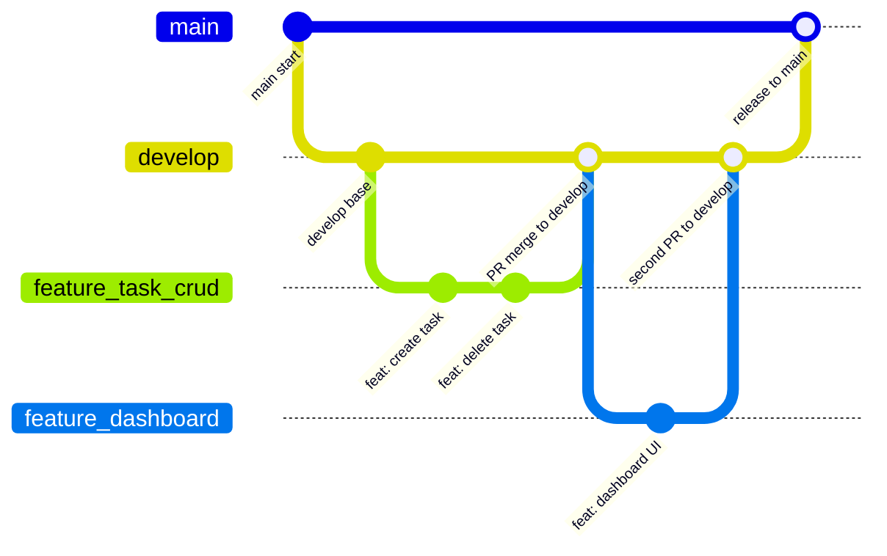

# Assignment 2 — Git Branching & Collaboration

## CO Mapped

**CO1**

## Aim

Implement branching strategies (feature branches, pull requests, and merging) to simulate collaborative development in a distributed team, using the Student Task Manager repository on GitHub.

## Tools Used

- Git (PowerShell on Windows)
- GitHub (`https://github.com/heyy-Haarsh/Student-Task-Manager`)
- Pull Requests for review and merge

## Prerequisites

- Git installed (`git --version`)
- Access to this GitHub repository
- Basic knowledge of `git add`, `git commit`, and `git push` (see Assignment 1)

## Related Files

- Full branching plan: [`../BRANCHING_STRATEGY.md`](../BRANCHING_STRATEGY.md)
- Application code used on feature branches: [`../app.py`](../app.py)
- Screenshots folder: [`./screenshots/`](./screenshots/)

## Branching strategy summary (own words)

The full written plan lives in [`../BRANCHING_STRATEGY.md`](../BRANCHING_STRATEGY.md). In short:

| Idea | What it means for this project |
|------|--------------------------------|
| Permanent branches | `main` stays release-ready. `develop` is where features integrate before a release. |
| Temporary branches | `feature/*` for new work, `bugfix/*` for fixes found on `develop`, `hotfix/*` for urgent production fixes off `main`. |
| Naming | Lowercase with hyphens, for example `feature/task-crud` or `bugfix/fix-task-date-validation`. |
| Commits | Prefer Conventional Commits such as `feat:`, `fix:`, `docs:`, in small steps. |
| Merge rules | Do not commit straight to `main` or `develop`. Open a Pull Request, get a review, pass checks, then merge. Prefer merge commits so branch history stays visible. Delete the feature branch after merge. |
| Release path | Features merge into `develop` first. When a release is ready, merge `develop` into `main` and tag it (for example `v1.0.0`). |
| Planned features | The strategy lists five feature areas: database setup, user authentication, task CRUD, dashboard UI, and notifications/reminders. |

### How this repo’s real history matches the plan

Git history shows real feature branches and Pull Request merges, which matches the collaboration idea in the strategy file. Branch names in history are a bit different from the written `feature/...` plan (for example `feature-delete-task` and `feature-modify-task`). A remote `develop` branch is not present in the current branch list; work and PR merges shown below landed on `main` / related lines of history.

### Branching model diagram

This Mermaid diagram follows the model described in [`../BRANCHING_STRATEGY.md`](../BRANCHING_STRATEGY.md):



## Real evidence from this repository

Commands below were run on this machine. Output is trimmed to the useful parts.

### Remote

```text
origin	https://github.com/heyy-Haarsh/Student-Task-Manager.git (fetch)
origin	https://github.com/heyy-Haarsh/Student-Task-Manager.git (push)
```

### Branches (`git branch -a`)

```text
* main
  remotes/origin/HEAD -> origin/main
  remotes/origin/abc
  remotes/origin/addprority
  remotes/origin/copilot/feature-list
  remotes/origin/feature-delete-task
  remotes/origin/feature-modify-task
  remotes/origin/feature/add
  remotes/origin/main
```

### Merge commits (`git log --merges --format="%h %an %s"`)

```text
fa41019 Harshad Chavan Merge branch 'main' of https://github.com/heyy-Haarsh/Student-Task-Manager
f01ca59 Harshad Chavan Add Node.js build and validation setup for Jenkins
f0cf59e Harshad Chavan Merge pull request #3 from heyy-Haarsh/feature-modify-task
9ad4f91 Harshad Chavan Merge pull request #2 from heyy-Haarsh/feature-delete-task
```

Real Pull Request examples:

| Merge commit | What it shows |
|--------------|---------------|
| `9ad4f91` | Merged PR #2 from `heyy-Haarsh/feature-delete-task` (feature tip `d2d0a08` by `heyy-Haarsh`) |
| `f0cf59e` | Merged PR #3 from `heyy-Haarsh/feature-modify-task` (feature tip `20e46a8` by `AsadPinjari`) |

### Contributors (`git shortlog -sne --all`)

History has more than one author, so this assignment work was done collaboratively:

```text
     8	Harshad Chavan <harshad@example.com>
     7	heyy-Haarsh <harshad08122006@gmail.com>
     6	Harshad Chavan <harshad08122006@gmail.com>
     5	Harshad Chavan <141698528+heyy-Haarsh@users.noreply.github.com>
     2	copilot-swe-agent[bot] <198982749+Copilot@users.noreply.github.com>
     1	AsadPinjari <asadpinjari0404@gmail.com>
     1	Kalyani Gadekar <kalyanigadekar01@gmail.com>
     1	ShreyasSonawane-17 <shreyassonawane017@gmail.com>
```

Unique people / bots found in history: Harshad Chavan / heyy-Haarsh, AsadPinjari, Kalyani Gadekar, ShreyasSonawane-17, and copilot-swe-agent[bot].

### Trimmed commit graph (`git log --graph --oneline --all`)

```text
* d74754a Add Assignment 1: Git Basics documentation
* 2ee0cca Add DevOps lab Cursor rules for assignment work.
* 6ce33ce Update .gitignore
* e116c53 Add assignment folders
*   fa41019 Merge branch 'main' of https://github.com/heyy-Haarsh/Student-Task-Manager
|\
| * 71aab04 Add Jenkins CI
| * 7b6d4fd Add jenkins CI demo
* | aa036d5 Restructure repo with assignment folders
|/
*   f01ca59 Add Node.js build and validation setup for Jenkins
|\
* \   9ad4f91 Merge pull request #2 from heyy-Haarsh/feature-delete-task
|\ \
| * | d2d0a08 Add delete task route and UI button
* | | 65211a5 Update project title in README.md
|/ /
* | bfb2d9c readme update
* | c63ca98 Initial Commit
| *   f0cf59e Merge pull request #3 from heyy-Haarsh/feature-modify-task
| |\
| | * 20e46a8 Add task priority feature
| |/
| * 94e09e7 Created basic node.js task manager application
|/
* f2a0f22 Initial commit
```

## Steps / Commands

The strategy document prefers branching from `develop`. Because this repo’s current local default is `main`, the commands below use `main` as the base (matching how PR #2 and PR #3 appear in history). If a `develop` branch is created later, replace `main` with `develop` as described in [`../BRANCHING_STRATEGY.md`](../BRANCHING_STRATEGY.md).

### 1. Update local `main`

```powershell
git checkout main
git pull origin main
```

Starts from the latest shared code before creating a feature branch.

### 2. Create a feature branch

```powershell
git checkout -b feature-delete-task
# or:
git switch -c feature/task-crud
```

Creates a short-lived branch for one feature so teammates can work without editing `main` directly.

Real example still on the remote: `origin/feature-delete-task` (commit `d2d0a08 Add delete task route and UI button`).

### 3. Commit work on the feature branch

```powershell
git add .
git commit -m "feat: add delete task route and UI button"
```

Saves the feature work as one or more small commits on the branch only.

### 4. Push the feature branch to GitHub

```powershell
git push -u origin feature-delete-task
```

Uploads the branch so a Pull Request can be opened and teammates can review it.

### 5. Open a Pull Request on GitHub

1. Open `https://github.com/heyy-Haarsh/Student-Task-Manager`
2. Choose **Compare & pull request** for the pushed branch
3. Set base branch to `main` (or `develop` if following the written strategy file)
4. Add a clear title and description
5. Create the Pull Request

Real history evidence: PR #2 (`feature-delete-task`) and PR #3 (`feature-modify-task`) were opened and later merged.

> 📸 **Screenshot to add:** `screenshots/01-github-branches.png`: GitHub Branches page listing feature branches for this repo

> 📸 **Screenshot to add:** `screenshots/02-open-pr.png`: An open Pull Request page (title, base/compare branches, files changed)

### 6. Review the Pull Request

On the PR page:

- Read the diff
- Leave review comments if something should change
- Approve when the change looks correct
- Confirm any CI checks pass (if configured)

> 📸 **Screenshot to add:** `screenshots/04-pr-review-comments.png`: PR Conversation or Files changed tab showing a review comment or approval

### 7. Merge the Pull Request

On GitHub, choose **Merge pull request** (merge commit is preferred in the strategy so history stays clear), then confirm.

Real merge commits:

```text
9ad4f91 Harshad Chavan Merge pull request #2 from heyy-Haarsh/feature-delete-task
f0cf59e Harshad Chavan Merge pull request #3 from heyy-Haarsh/feature-modify-task
```

> 📸 **Screenshot to add:** `screenshots/03-merged-pr.png`: A merged Pull Request page showing “Merged” status

### 8. Delete the feature branch after merge

On GitHub, use **Delete branch** on the merged PR page, or locally:

```powershell
git branch -d feature-delete-task
git push origin --delete feature-delete-task
```

Keeps the branch list clean after the work is already in history.

Note: `origin/feature-delete-task` and `origin/feature-modify-task` are still listed on the remote in the captured `git branch -a` output, so those remotes were not deleted yet.

### 9. Sync local `main` after the merge

```powershell
git checkout main
git pull origin main
```

Downloads the merged PR commits so the local `main` matches GitHub.

### 10. View collaboration graph / collaborators (GitHub UI)

- **Insights → Network** (or the commit graph) shows how branches diverged and merged
- **Settings → Collaborators** (or the repo contributors view) shows who can push / who contributed

> 📸 **Screenshot to add:** `screenshots/05-network-graph.png`: GitHub Network / graph view showing branch merges for this repo

> 📸 **Screenshot to add:** `screenshots/06-collaborators.png`: GitHub collaborators or contributors page for this repository

### 11. Merge conflict — illustrative worked example

The following conflict walk-through is an illustrative example for learning. It is not copied from a specific conflict commit in this repository’s history.

**How a conflict can be created**

```powershell
git checkout main
git pull origin main
git switch -c feature/conflict-demo

# Person A changes the same line in app.py on this branch, then:
git add app.py
git commit -m "feat: change default task list text"
git push -u origin feature/conflict-demo

# Meanwhile on main (or another branch), Person B edits the same line and merges first.
# When Person A opens a PR or runs:
git checkout main
git pull origin main
git merge feature/conflict-demo
```

Git stops with a conflict if both sides changed the same lines.

**How to resolve it**

1. Open the conflicted file (for example `app.py`)
2. Find markers like `<<<<<<<`, `=======`, `>>>>>>>`
3. Keep the correct final code and delete the markers
4. Stage and finish the merge:

```powershell
git add app.py
git commit -m "merge: resolve conflict in app.py task list text"
git push origin main
```

After that, `git status` should be clean and the merge commit appears in `git log`.

## Output

### Captured output

The branch list, merge-commit list, shortlog, remote URL, and trimmed graph in the **Real evidence** section were taken from this repository. They are not invented.

### Screenshot placeholders

> 📸 **Screenshot to add:** `screenshots/01-github-branches.png`: GitHub Branches page listing feature branches for this repo

> 📸 **Screenshot to add:** `screenshots/02-open-pr.png`: An open Pull Request page (title, base/compare branches, files changed)

> 📸 **Screenshot to add:** `screenshots/03-merged-pr.png`: A merged Pull Request page showing “Merged” status

> 📸 **Screenshot to add:** `screenshots/04-pr-review-comments.png`: PR Conversation or Files changed tab showing a review comment or approval

> 📸 **Screenshot to add:** `screenshots/05-network-graph.png`: GitHub Network / graph view showing branch merges for this repo

> 📸 **Screenshot to add:** `screenshots/06-collaborators.png`: GitHub collaborators or contributors page for this repository

## Observations

1. [`../BRANCHING_STRATEGY.md`](../BRANCHING_STRATEGY.md) describes a simplified Git Flow (`main`, `develop`, `feature/*`, `bugfix/*`, `hotfix/*`) with PR-only merges.
2. Real history already has collaborative signals: multiple authors, feature branches on `origin`, and merge commits for PR #2 and PR #3.
3. AsadPinjari authored `20e46a8` on `feature-modify-task`; that branch was merged in `f0cf59e`. heyy-Haarsh authored `d2d0a08` on `feature-delete-task`; that branch was merged in `9ad4f91`.
4. Current remotes still include old feature branches, which is useful evidence for screenshots even if the written strategy says to delete them after merge.
5. A dedicated `develop` branch from the strategy file is not present in the captured `git branch -a` output.

## Conclusion

Feature branches, Pull Requests, reviews, and merges are the practical way this team shares work without editing `main` directly. This repository’s history already shows multi-author collaboration and real PR merges, which supports **CO1** for Git branching and collaborative development.
