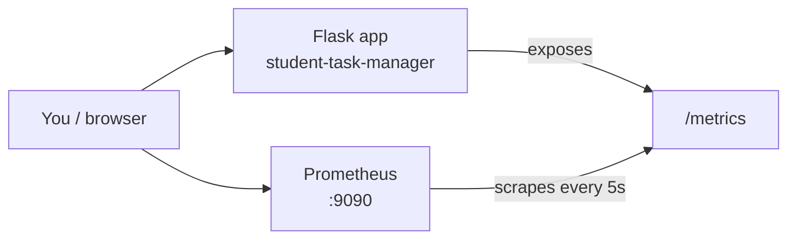

# Assignment 7 — Monitoring with Prometheus

## CO Mapped

**CO4**

## Aim

Set up Prometheus to collect and monitor Student Task Manager performance metrics in real time.

## Tools Used

- Prometheus (`prom/prometheus`)
- Docker Compose
- Flask + `prometheus-client==0.21.1`
- Root app: [`../app.py`](../app.py), [`../Dockerfile`](../Dockerfile), [`../requirements.txt`](../requirements.txt)

## Prerequisites

- Docker Desktop installed and running
- This repository checked out locally
- Assignment 4-style image build working (Compose builds from the root Dockerfile)

## Related Files

- Instrumented app: [`../app.py`](../app.py)
- Dependencies: [`../requirements.txt`](../requirements.txt) (`prometheus-client==0.21.1`)
- Scrape config: [`./prometheus.yml`](./prometheus.yml)
- Stack: [`./docker-compose.yml`](./docker-compose.yml)
- Screenshots: [`./screenshots/`](./screenshots/)

## What is Prometheus?

Prometheus is an open-source **monitoring** system that stores metrics as **time series** (values with timestamps and labels).

| Idea | Simple meaning |
|------|----------------|
| Pull model | Prometheus regularly **scrapes** (HTTP GETs) a `/metrics` endpoint; the app does not push every sample. |
| Scraping | Every `scrape_interval` (here **5s**), Prometheus collects text metrics from configured targets. |
| Time series | Each metric+label set is a series you can graph and query with **PromQL**. |

## Architecture



Inside Compose, Prometheus scrapes `app:5000` using Docker DNS (see [`prometheus.yml`](./prometheus.yml)).

## Application metrics (what was added)

Minimal instrumentation in [`../app.py`](../app.py):

| Metric | Type | Labels | Purpose |
|--------|------|--------|---------|
| `http_requests_total` | Counter | `method`, `endpoint`, `status` | Count of HTTP requests |
| `http_request_duration_seconds` | Histogram | `method`, `endpoint` | Request latency |
| `/metrics` | Endpoint | — | Prometheus scrape target (not counted by the hooks) |

`before_request` / `after_request` skip `/metrics` so scrapes do not inflate traffic counters. Existing routes (`/`, `/add`, `/delete/...`) behave the same as before.

## Steps / Commands

### 1. Review config

Scrape job `student-task-manager` targets `app:5000` every 5s:

```yaml
# from prometheus.yml
global:
  scrape_interval: 5s
scrape_configs:
  - job_name: student-task-manager
    metrics_path: /metrics
    static_configs:
      - targets: ["app:5000"]
```

### 2. Validate Compose (no containers started here)

From this folder:

```powershell
cd Assignment-7-Monitoring-Prometheus
docker compose config
```

### 3. Start the stack (when you are ready)

```powershell
cd Assignment-7-Monitoring-Prometheus
docker compose up --build
```

- App: `http://127.0.0.1:5000`
- Metrics: `http://127.0.0.1:5000/metrics`
- Prometheus UI: `http://127.0.0.1:9090`

### 4. Verify `/metrics` in the browser

Open `http://127.0.0.1:5000/metrics`. You should see Prometheus text exposition, including lines for `http_requests_total` and `http_request_duration_seconds_bucket` (after some traffic).

> 📸 **Screenshot to add:** `screenshots/01-metrics-endpoint.png`: Browser showing `/metrics` text output

### 5. Verify Prometheus target is UP

1. Open `http://127.0.0.1:9090`
2. Go to **Status → Targets**
3. Job `student-task-manager` should show state **UP**

> 📸 **Screenshot to add:** `screenshots/02-prometheus-targets-up.png`: Targets page with `student-task-manager` UP

### 6. Generate traffic (PowerShell)

```powershell
1..30 | ForEach-Object {
  Invoke-WebRequest -Uri http://127.0.0.1:5000/ -UseBasicParsing | Out-Null
  Start-Sleep -Milliseconds 200
}
```

Optional POST to add a task:

```powershell
Invoke-WebRequest -Uri http://127.0.0.1:5000/add -Method POST -Body @{ task = "Prometheus lab task" } -UseBasicParsing
```

### 7. Run example PromQL queries

In Prometheus → **Graph**, paste a query and click **Execute**.

| # | PromQL | What it shows |
|---|--------|----------------|
| 1 | `http_requests_total` | Raw request counter samples by method, endpoint, status |
| 2 | `rate(http_requests_total[1m])` | Per-second request rate over the last 1 minute |
| 3 | `sum by (endpoint) (rate(http_requests_total[1m]))` | Request rate grouped by endpoint |
| 4 | `histogram_quantile(0.95, sum by (le, endpoint) (rate(http_request_duration_seconds_bucket[5m])))` | Approximate 95th percentile latency by endpoint |
| 5 | `up` | `1` if the scrape target is healthy, `0` if down |
| 6 | `sum(rate(http_requests_total{status=~"5.."}[5m]))` | Rate of **5xx** error responses |
| 7 | `sum(rate(http_requests_total{status=~"4.."}[5m]))` | Rate of **4xx** client errors |
| 8 | `sum by (status) (rate(http_requests_total[5m]))` | Request rate broken down by HTTP status |

> 📸 **Screenshot to add:** `screenshots/03-promql-graph.png`: Graph tab plotting a PromQL query (for example request rate)

> 📸 **Screenshot to add:** `screenshots/04-promql-table.png`: Query results in Table view

### 8. Stop the stack

```powershell
docker compose down
```

## Output

### Compose validation (captured)

`docker compose config` from this folder succeeded (exit code 0). Trimmed resolved config:

```text
name: assignment-7-monitoring-prometheus
services:
  app:
    build:
      context: C:\Users\Harshad Chavan\Student-Task-Manager
      dockerfile: Dockerfile
    ports:
      - published: "5000" → target: 5000
  prometheus:
    image: prom/prometheus:v2.55.1
    ports:
      - published: "9090" → target: 9090
    volumes:
      - ./prometheus.yml → /etc/prometheus/prometheus.yml (ro)
```

Note: `docker info` still could not reach the Docker Desktop engine on this machine at documentation time, but the Compose file itself validated. Containers were **not** started (waiting for your approval).

### Tests note

`npm test` was run after the instrumentation change. It **failed** on a **pre-existing** issue: root `index.html` is missing (`tests/test.js` expects it; HTML lives under `public/` / `templates/`). That failure is unrelated to the Prometheus hooks. Per lab rules the test file was not changed.

### Screenshot placeholders

> 📸 **Screenshot to add:** `screenshots/01-metrics-endpoint.png`: Browser showing `/metrics` text output

> 📸 **Screenshot to add:** `screenshots/02-prometheus-targets-up.png`: Targets page with `student-task-manager` UP

> 📸 **Screenshot to add:** `screenshots/03-promql-graph.png`: Graph tab plotting a PromQL query (for example request rate)

> 📸 **Screenshot to add:** `screenshots/04-promql-table.png`: Query results in Table view

## Observations

1. Prometheus **pulls** metrics; the Flask app only exposes `/metrics`.
2. Skipping `/metrics` in the hooks avoids counting scrapes as user traffic.
3. Counter labels include `status`, so 4xx/5xx error rates are easy in PromQL.
4. Histogram buckets support percentile queries such as p95 latency.
5. Compose uses service DNS `app:5000` so Prometheus reaches the app inside the Docker network.

## Conclusion

Prometheus scrapes the Student Task Manager `/metrics` endpoint every 5 seconds and stores request count and latency time series. With PromQL you can watch live traffic, errors, and latency — supporting **CO4** for real-time application monitoring.
