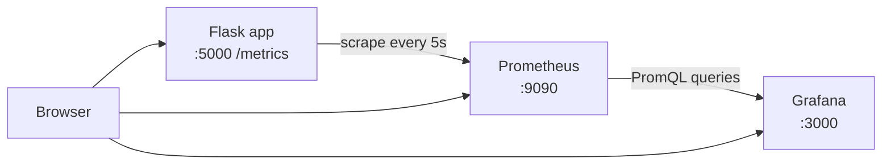

# Assignment 8 — Visualization with Grafana

## CO Mapped

**CO4**

## Aim

Create Grafana dashboards to visualize and analyze the real-time metrics collected by Prometheus for the Student Task Manager.

## Tools Used

- Grafana (`grafana/grafana`)
- Prometheus (from Assignment 7 config)
- Docker Compose
- Provisioned dashboard JSON

## Prerequisites

- Assignment 7 complete (`/metrics` in [`../app.py`](../app.py) and [`../Assignment-7-Monitoring-Prometheus/prometheus.yml`](../Assignment-7-Monitoring-Prometheus/prometheus.yml)) — **verified before writing this assignment**
- Docker Desktop installed
- PowerShell

## Related Files

- Stack: [`./docker-compose.yml`](./docker-compose.yml)
- Datasource provisioning: [`./provisioning/datasources/prometheus.yml`](./provisioning/datasources/prometheus.yml)
- Dashboard provider: [`./provisioning/dashboards/dashboards.yml`](./provisioning/dashboards/dashboards.yml)
- Dashboard: [`./dashboards/student-task-manager.json`](./dashboards/student-task-manager.json)
- Prometheus scrape config (shared): [`../Assignment-7-Monitoring-Prometheus/prometheus.yml`](../Assignment-7-Monitoring-Prometheus/prometheus.yml)
- Screenshots: [`./screenshots/`](./screenshots/)

## What is Grafana?

Grafana is a **visualization** tool. It does not scrape your app itself. It connects to a data source (here Prometheus), runs queries, and shows graphs, stats, and tables on dashboards.

| Tool | Role |
|------|------|
| Prometheus | Collects and stores time-series metrics (`/metrics` scrape). |
| Grafana | Displays those metrics with dashboards and PromQL panels. |

## Architecture



## Steps / Commands

### 1. Validate files (no containers started without approval)

```powershell
cd Assignment-8-Visualization-Grafana
python -c "import json; json.load(open('dashboards/student-task-manager.json', encoding='utf-8')); print('dashboard JSON OK')"
docker compose config
```

### 2. Start the full stack

```powershell
cd Assignment-8-Visualization-Grafana
docker compose up --build
```

Services:

| Service | URL |
|---------|-----|
| App | `http://127.0.0.1:5000` |
| Metrics | `http://127.0.0.1:5000/metrics` |
| Prometheus | `http://127.0.0.1:9090` |
| Grafana | `http://localhost:3000` |

### 3. Log in to Grafana

1. Open `http://localhost:3000`
2. Default credentials from Compose env: **admin / admin**
3. **Change the admin password** when Grafana asks (do not leave the default on a shared machine)

> 📸 **Screenshot to add:** `screenshots/01-grafana-login.png`: Grafana login page at `http://localhost:3000`

### 4. Confirm the Prometheus data source

**Provisioned path (automatic):** Compose mounts [`./provisioning`](./provisioning), so a datasource named **Prometheus** at `http://prometheus:9090` should already exist and be the default.

**Manual alternative:**

1. **Connections → Data sources → Add data source → Prometheus**
2. URL: `http://prometheus:9090`
3. Click **Save & test** — expect a success message

> 📸 **Screenshot to add:** `screenshots/02-datasource-save-test.png`: Data source Save & test success for Prometheus

### 5. Open the provisioned dashboard

Go to **Dashboards** and open **Student Task Manager**. Refresh is set to **5s**.

If you want to build a panel by hand instead:

1. **Dashboards → New → New dashboard → Add visualization**
2. Select datasource **Prometheus**
3. Enter a PromQL expression (examples in the table below)
4. Set panel type (Stat / Time series / Pie)
5. Apply and save the dashboard

> 📸 **Screenshot to add:** `screenshots/03-empty-dashboard-building.png`: Empty / new dashboard while adding a first panel

> 📸 **Screenshot to add:** `screenshots/05-panel-edit-promql.png`: Panel edit mode showing a PromQL query

### 6. Generate traffic so graphs are not empty

```powershell
1..40 | ForEach-Object {
  Invoke-WebRequest -Uri http://127.0.0.1:5000/ -UseBasicParsing | Out-Null
  Start-Sleep -Milliseconds 150
}
```

Optional:

```powershell
Invoke-WebRequest -Uri http://127.0.0.1:5000/add -Method POST -Body @{ task = "Grafana lab task" } -UseBasicParsing
```

> 📸 **Screenshot to add:** `screenshots/04-final-dashboard-live.png`: Final Student Task Manager dashboard with live data after traffic

### 7. Stop the stack

```powershell
docker compose down
```

Named volume `grafana-data` keeps Grafana settings until you remove volumes with `docker compose down -v`.

## Panel PromQL reference

These match the real metric names from Assignment 7 (`http_requests_total`, `http_request_duration_seconds`, and Prometheus `up`).

| Panel | Type | PromQL | Meaning |
|-------|------|--------|---------|
| Total requests | Stat | `sum(http_requests_total)` | All counted HTTP requests so far |
| App up/down | Stat | `up{job="student-task-manager"}` | `1` if Prometheus scrape target is healthy |
| Request rate by endpoint | Time series | `sum by (endpoint) (rate(http_requests_total[1m]))` | Requests/sec per path |
| Error rate 4xx/5xx | Time series | `sum(rate(http_requests_total{status=~"4.."}[5m]))` and `sum(rate(http_requests_total{status=~"5.."}[5m]))` | Client vs server error rates |
| p95 latency | Time series | `histogram_quantile(0.95, sum by (le, endpoint) (rate(http_request_duration_seconds_bucket[5m])))` | 95th percentile latency by endpoint |
| Requests by status code | Pie | `sum by (status) (http_requests_total)` | Share of responses per HTTP status |

## How to analyze the graphs

| What you see | Likely meaning |
|--------------|----------------|
| Spike in request rate | Sudden traffic (your PowerShell loop, demo, or many users) |
| Rising p95 latency | App or machine under load; slow responses for some requests |
| Non-zero 4xx line | Bad requests / not found / client mistakes |
| Non-zero 5xx line | Server-side failures — investigate app logs |
| App up/down = DOWN (`0`) | Prometheus cannot scrape `app:5000` (container stopped or wrong network) |

## Output

### Validation (captured)

Dashboard JSON parse:

```text
dashboard JSON OK
```

`docker compose config` exit code **0**. Trimmed services:

```text
name: assignment-8-visualization-grafana
services:
  app:        build context repo root, port 5000
  prometheus: prom/prometheus:v2.55.1, mounts Assignment-7 prometheus.yml
  grafana:    grafana/grafana:11.2.0, port 3000, volume grafana-data
```

Containers were **not** started without approval.

### Screenshot placeholders

> 📸 **Screenshot to add:** `screenshots/01-grafana-login.png`: Grafana login page at `http://localhost:3000`

> 📸 **Screenshot to add:** `screenshots/02-datasource-save-test.png`: Data source Save & test success for Prometheus

> 📸 **Screenshot to add:** `screenshots/03-empty-dashboard-building.png`: Empty / new dashboard while adding a first panel

> 📸 **Screenshot to add:** `screenshots/04-final-dashboard-live.png`: Final Student Task Manager dashboard with live data after traffic

> 📸 **Screenshot to add:** `screenshots/05-panel-edit-promql.png`: Panel edit mode showing a PromQL query

## Observations

1. Grafana visualizes; Prometheus stores and scrapes.
2. Provisioning means the datasource and dashboard appear automatically on first start.
3. Default Grafana password `admin` must be changed after login.
4. Dashboard refresh is **5s**, matching the lab’s near-real-time goal.
5. Without generated traffic, counters and rates stay flat or empty — use the PowerShell loop.

## Conclusion

Grafana dashboards turn Prometheus metrics into live panels for traffic, errors, latency, and target health. Together with Assignment 7, this completes **CO4** monitoring and visualization for the Student Task Manager.
