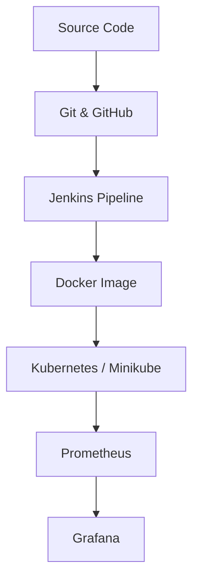

# ⚙️ DevOps for Scalable Systems Lab

Practical lab work record of 8 DevOps assignments, built around a
**Student Task Manager** web application (Python / Flask).

## 🧪 Assignments

| No. | Assignment | CO | Folder |
|-----|-----------|----|--------|
| 1 | Git Basics | CO1 | [Open](./Assignment-1-Git-Basics) |
| 2 | Git Branching & Collaboration | CO1 | [Open](./Assignment-2-Git-Branching-Collaboration) |
| 3 | Jenkins Build | CO1 | [Open](./Assignment-3-Jenkins-Build) |
| 4 | Dockerization | CO2 | [Open](./Assignment-4-Dockerization) |
| 5 | Kubernetes Deployment | CO2 | [Open](./Assignment-5-Kubernetes-Deployment) |
| 6 | Jenkins Pipeline with Automated Testing | CO3 | [Open](./Assignment-6-Jenkins-Pipeline-Automated-Testing) |
| 7 | Monitoring with Prometheus | CO4 | [Open](./Assignment-7-Monitoring-Prometheus) |
| 8 | Visualization with Grafana | CO4 | [Open](./Assignment-8-Visualization-Grafana) |

## 🔄 Workflow



## 🛠️ Tech Stack
Python, Flask, Git, GitHub, Jenkins, Docker, Kubernetes (Minikube), Prometheus, Grafana

## ▶️ Run Locally
```bash
pip install -r requirements.txt
python app.py
```

## 📁 Key Files
| File | Used in |
|------|---------|
| `BRANCHING_STRATEGY.md` | Assignment 2 |
| `Jenkinsfile`, `tests/` | Assignments 3 and 6 |
| `Dockerfile` | Assignment 4 |
| `deployment.yaml`, `service.yaml` | Assignment 5 |

## 🎯 Objective
<write 1–2 sentences in your own words>